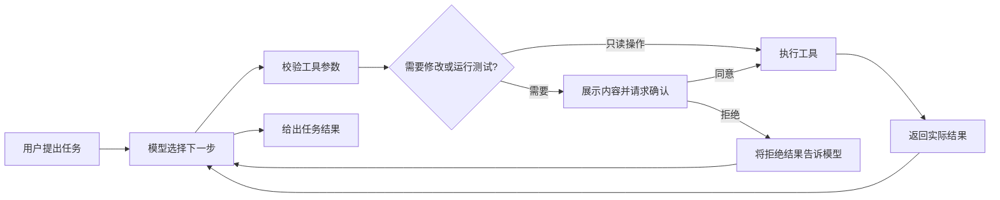

# Herta Agent — 轻量级 CLI Coding Agent

在终端里指定一个项目，用自然语言交代编码任务，模型自己选择工具搜索代码、读取文件、提出修改并运行测试。Herta 用 Python 实现模型请求、工具执行、结果回填的主循环，并处理人工审批、编辑冲突、上下文和会话恢复。

**技术栈：** Python · asyncio · Pydantic · httpx · SQLite · DeepSeek API（Tool Calling）· Rich / prompt_toolkit

[安装与使用](docs/CLI_GUIDE.md) · [任务演示](docs/DEMO.md) · [核心调用链](docs/architecture/cli-v1.md) · [项目案例](https://herta27.top/posts/herta-cli-case-study/) · [个人博客](https://herta27.top/)

## 核心流程



## 主要实现

| 模块 | 具体做了什么 |
| --- | --- |
| Agent 主循环 | 模型请求、工具执行、结果回填的有界循环；分离模型适配、工具注册和执行逻辑 |
| 工具系统 | Pydantic 校验参数；提供搜索、读取、编辑、新建文件和 unittest 测试五类工具 |
| 人工审批 | 编辑前展示实际 Diff；编辑、新建文件和运行测试都逐次确认 |
| 编辑冲突检测 | SHA-256 核对读取、预览与写入期间的文件变化，发现外部修改时拒绝覆盖 |
| 上下文管理 | 按 Token 预算选取完整消息轮次，保留工具调用与结果的对应关系 |
| 会话恢复 | SQLite 保存会话和执行结果，支持跨进程继续对话，恢复时不重放历史工具操作 |

## 验证结果

接入 DeepSeek API，用两项实际编码任务验证模型自主选择工具、修改代码并运行测试：

| 任务 | 实际结果 |
| --- | --- |
| 修复购物车结算错误 | 定位商品数量与运费计算的关联问题，修改两个模块，7 项测试通过，并由独立检查器核对行为与原测试是否保留 |
| 给字频 CLI 增加 JSON 输出 | 新增输出模块与 5 项测试；读取新增测试的失败信息后修正，最终 8 项测试通过 |
| 审批、冲突与恢复 | 保留拒绝编辑、外部修改导致写入冲突、会话中断后恢复的操作记录 |
| CLI 工程回归 | 原有 120 项 CLI 与检查器测试通过；另有 4 项 Windows 启动测试通过 |

需求、工具轨迹、实际改动与独立检查见 [案例验证记录](docs/verification/coding-cases-20261024/verification.md)。安装、终端入口和恢复检查见 [CLI 验收](docs/verification/cli-v1-20261022/verification.md) 与 [Windows 启动修复](docs/verification/startup-20261025.md)。

## 安装

当前 CLI 支持 Windows、Python 3.12+。

```powershell
git clone https://github.com/theHerta27/herta-agent.git
cd herta-agent
py -3.12 -m venv .venv-cli
.\.venv-cli\Scripts\python.exe -m pip install ./backend
```

配置 `DEEPSEEK_API_KEY` 环境变量后，指定要处理的项目目录：

```powershell
.\.venv-cli\Scripts\herta-agent.exe --provider openai --repo '你的项目目录'
```

输入任务后开始交互，输入 `/exit` 退出。也可以双击 **启动CLI.cmd**，按提示选择项目目录。默认模型配置为 DeepSeek；可通过 `HERTA_BASE_URL`、`HERTA_MODEL`、`HERTA_API_KEY` 接入其他支持 Tool Calling 的兼容服务。

## 跑一次编码演示

在仓库根目录运行以下一行，新建一份未修复的演示项目并启动任务：

```powershell
.\启动CLI.cmd -Case checkout
```

演示 JSON 输出功能时，改为 `-Case wordcount`。编辑和测试均需确认；结束后终端会打印独立检查命令。先体验启动流程而不请求模型，可以加 `-Demo`，该模式只回显，不修改演示代码。

## 会话恢复

```powershell
.\.venv-cli\Scripts\herta-agent.exe --repo '你的项目目录' --list-sessions
.\.venv-cli\Scripts\herta-agent.exe --provider openai --repo '你的项目目录' --resume '会话ID'
```

恢复后继续输入任务。历史工具结果会进入对话，已经执行过的操作不会因恢复而再次执行。

## 运行测试

```powershell
$env:PYTHONPATH = 'backend'
.\.venv-cli\Scripts\python.exe -m unittest discover -s backend/tests -p 'test_cli*.py' -v
```

## 设计取舍

Herta 参考编码助手的公开机制，自行实现核心 Harness。当前工具重点支持 Python unittest；文件权限检查和人工审批用于控制操作，测试仍以当前用户权限执行。

`main` 展示当前 CLI。旧桌面界面、角色互动与相关学习资料保留在历史目录和分支中，日常入口使用 **启动CLI.cmd**。

[灰塔](https://github.com/theHerta27/graytower-agent) 是另一个独立项目：用 LangGraph / LangChain 面向游戏规则修复，进一步处理 Git 工作树、Docker 检查、项目记忆和人工交付。
