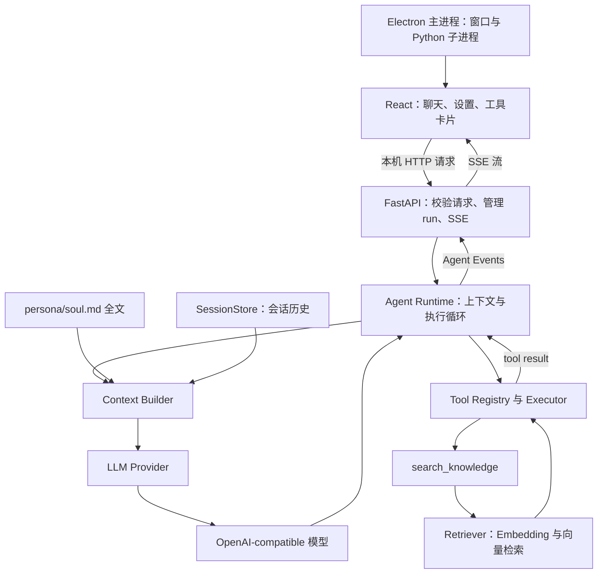

# Herta Agent V1 架构方案

状态：V1 架构设计；2026-09-20 已完成 Phase 3。在 Phase 2 工具闭环上加入独立 Context Builder、soul.md 完整快照与哈希、CLI 必需 Persona 及加载失败后的会话恢复。Runtime 只依赖上下文接口，不含角色文件路径或人格规则。API、持久化、事件、RAG 和桌面仍为后续计划。当前运行命令与验证见 docs/phase-3-walkthrough.md；下文第 3 节保留 Phase 0 当时的目录快照。

目标是一个独立桌面 Agent：Electron + React + TypeScript + Vite，连接本机 Python 3.12+ / FastAPI / Pydantic / asyncio Runtime。第一版只提供一个大黑塔风格 Persona。Hermes 仅作为参考。

## 1. 先理解 6 个概念

| 概念 | 在这个项目里是什么 |
| --- | --- |
| Session | 一段可重新打开的对话，拥有稳定 session_id 与有序历史 |
| Run | 用户发送一条消息后的一次执行，拥有 run_id，可完成、失败或取消 |
| Step | Run 内的一次模型请求尝试；一轮用户输入可以经历多次 Step |
| Context | 本次模型能看见的 system、历史、本轮消息；不是数据库里的所有东西 |
| Tool | 已注册的具名能力，具有参数模型和执行函数；由 Runtime 验证并执行 |
| Event | Runtime 对外发出的事实通知，例如开始调用工具、检索完成、运行结束 |

举例：一个 Session 聊了 3 轮，就是 3 个 Run。第二轮先请求模型、调用知识检索、再请求模型回答，就是该 Run 的 2 个 Step。

## 2. 组件关系与依赖方向



Runtime 不导入 FastAPI、React 或 Electron。Provider 不创建会话、不执行工具。Registry 不请求 LLM。Retriever 不决定“要不要检索”，这个决定来自模型的 tool call。

Context Builder 负责整理消息；它不会偷偷检索 RAG，也不会承担整个 Agent Loop。这样每个模块都可以脱离桌面单独测试。

## 3. 当前实际目录与最终目标目录

Phase 0 当前只新增文档、工作记录、忽略规则和参考源码目录：

```text
herta-agent/
├─ 大黑塔原始语料.md                 # 用户原文件，未移动
├─ 大黑塔原始语料的整理思路.md       # 用户原文件，未移动
├─ hermes-agent-main.zip             # 原始参考快照，未改动
├─ references/
│  └─ hermes-agent-main/             # 完整参考源码，原许可证保留
├─ docs/
│  ├─ hermes-analysis.md             # Hermes 的真实实现在哪里
│  ├─ architecture.md                # Herta 将如何实现
│  ├─ reuse-plan.md                  # 逐模块取舍与来源记录
│  └─ phase-0-walkthrough.md         # 自己动手复现本阶段
├─ LICENSES/
│  └─ Hermes-MIT.txt                 # 根许可证的原样副本
├─ .gitignore
├─ task_plan.md
├─ findings.md
└─ progress.md
```

下面才是逐阶段落地的目标结构。尚未创建这些业务文件，不需要现在手动创建一堆空文件：

```text
herta-agent/
├─ apps/desktop/                    # Phase 6
│  ├─ electron/
│  │  ├─ main.ts                    # 窗口、后端启动/退出、凭据边界
│  │  └─ preload.ts                 # 窄接口桥接，不暴露任意 Node 能力
│  ├─ src/
│  │  ├─ components/               # Sidebar、Chat、ToolEventCard、Settings
│  │  ├─ api/                      # HTTP、SSE 解析与类型
│  │  ├─ App.tsx
│  │  └─ main.tsx
│  ├─ package.json
│  └─ vite.config.ts
├─ backend/
│  ├─ pyproject.toml               # Phase 1；独立 Python 包及测试配置
│  ├─ herta_agent/
│  │  ├─ __init__.py
│  │  ├─ __main__.py               # Phase 1 教学 CLI；不依赖桌面
│  │  ├─ config.py                 # 配置与验证
│  │  ├─ api/                      # Phase 5
│  │  │  ├─ app.py                 # FastAPI 生命周期与依赖装配
│  │  │  ├─ routes.py              # sessions/runs/settings API
│  │  │  ├─ runs.py                # 持有 asyncio Task、队列与取消状态
│  │  │  └─ sse.py                 # AgentEvent → SSE 帧
│  │  ├─ runtime/
│  │  │  ├─ agent.py               # 执行循环，不含 HTTP 路由
│  │  │  ├─ messages.py            # 内部 Message / ToolCall 类型
│  │  │  ├─ context.py             # Phase 3 完整 Context Builder
│  │  │  ├─ session.py             # 历史、SessionStore；逐步加入 SQLite
│  │  │  ├─ events.py              # 显式事件契约
│  │  │  └─ errors.py              # 清晰的内部错误类型
│  │  ├─ llm/
│  │  │  ├─ base.py                # LLMProvider 与内部响应类型
│  │  │  └─ openai_compatible.py   # SDK 适配、流式组装、网络错误归一化
│  │  ├─ tools/                    # Phase 2
│  │  │  ├─ registry.py            # 名称 → ToolSpec、schema 生成
│  │  │  ├─ executor.py            # 校验、timeout、结果封装
│  │  │  ├─ echo.py                # 无副作用的教学工具
│  │  │  └─ search_knowledge.py    # Phase 4 检索工具
│  │  └─ rag/                      # Phase 4
│  │     ├─ ingest.py              # 文档清洗、分块、建立索引
│  │     ├─ embeddings.py          # 查询/文档使用同一 embedding 契约
│  │     ├─ retriever.py           # top-k 检索与来源元数据
│  │     └─ store.py               # 向量与 chunk 元数据存取
│  └─ tests/                      # 从 Phase 1 起随行为逐步加入
├─ persona/soul.md                # Phase 3；运行时完整注入
├─ knowledge/                     # Phase 4；整理后的知识事实
├─ data/
│  ├─ raw/persona/                # Phase 3；原始证据，与知识目录隔离
│  └─ derived/persona_evidence.jsonl
├─ evals/                         # Phase 8：Persona、RAG 场景验收
├─ docs/
├─ LICENSES/
└─ README.md                      # 随阶段补充；Phase 8 完善
```

目录按“谁承担什么职责”拆分，不按一个页面或一个巨型 Agent 类堆积。Phase 1 只建立当时需要的少数文件，后续阶段再展开以上目录。

开发期运行数据放在 `.local/`，包括会话 DB、向量索引、非公开配置；打包后使用 Electron userData 所在的应用数据目录，由主进程把绝对路径传给后端。安装目录不承受运行时写入，不能依赖启动时 cwd 来寻找 soul.md。

## 4. 一条用户请求的完整生命周期

1. 用户从桌面打开或创建 Session，发送文本。
2. React 通过本机 API 提交请求；后端验证输入、配置与同 Session 是否已有活跃 Run。
3. 后端保存用户消息，创建 Run，发 `run.started`。同一个 Session 同时只允许一个 Run；第二个返回明确的冲突，不并发改历史。
4. Context Builder 读取本轮 soul.md 全文快照，载入历史，构建稳定 system 与工作消息。
5. Loop 检查取消和 max_steps，向 Provider 传 messages 与工具 schemas，发 `llm.started`。
6. Provider 收到文本增量，转成内部 delta；Runtime 发 `llm.delta`，桌面增量显示文本。
7. Provider 累积完整模型响应与 tool_calls。没有工具调用时提交完整 assistant 回复，发 `run.completed`，结束。
8. 有工具调用时，先提交含 tool_calls 的 assistant 消息，再按返回顺序逐个处理工具。V1 不并行执行工具。
9. Registry 按名称查找工具；Executor 解析完整 JSON，用参数模型校验；通过后发 `tool.started` 并执行。
10. 若为 search_knowledge：向量化 query，检索 top-k，得到 chunks 与来源；产生 `rag.retrieved` 事件。
11. Executor 统一成功/失败结果；Runtime 写入匹配 tool_call_id 的 tool message。保存成功后发 `tool.completed` 或 `tool.failed`。
12. Loop 回到第 5 步：仍携带同一份 Persona，也携带刚写入的工具调用及结果，让 LLM 形成回答。
13. 结束时保存最终状态，清理任务、模型流与资源，释放 Session 占用。UI 依终态停止“运行中”显示。

普通技术问题走 1–7，无需每轮固定检索。世界观问题可走 1–12，检索次数仍受预算约束。LLM 决定使用工具，Runtime 决定调用是否有效、能否执行。

## 5. 核心契约和不可破坏的规则

### LLM Provider

计划提供 `LLMProvider` 抽象和一个 OpenAI-compatible 实现。早期先用非流式接口打通循环，Phase 5 增加流式入口；两者归一化到相同 Message / ToolCall 结构。

适配器负责 API Key、Base URL、Model 的连接配置、网络调用、响应结构、工具参数分片拼接与错误转换。Runtime 不依赖供应商 SDK 的响应类。

第一版协议明确限定为 Chat Completions 风格 messages / tools / tool_calls。兼容商未实现工具调用或返回不完整 tool_calls 时，显示能力/协议错误，不假装成功。流结束前不执行工具；流异常时不自动重复已经显示的文本或已经执行的工具。

### Tool Registry 与参数模型

ToolSpec 只需名称、描述、Pydantic 参数类型、异步 handler、timeout。启动时显式注册，重复名称直接报错；不做扫描目录、导入任意插件或 MCP 工具发现。

参数类型是单一来源：`model_json_schema()` 生成描述；`model_validate_json()` 验证模型给出的完整 JSON。采用禁止额外字段与明确类型约束的参数类；校验失败不进入 handler。Pydantic 的 schema 生成能力见[官方 JSON Schema 文档](https://docs.pydantic.dev/latest/concepts/json_schema/)。

统一工具结果示意：

```json
{"ok":true,"data":{"chunks":[]},"error":null}
```

```json
{"ok":false,"data":null,"error":{"code":"tool_timeout","message":"知识检索超过执行期限"}}
```

完整 schema 仍需按所选兼容商的实际支持范围做契约测试。V1 的工具参数先保持简单，不为了“通用”支持任意复杂 schema。

### 消息、事件、持久化分别负责什么

- Message 是模型上下文协议：user、assistant、tool，以及 assistant.tool_calls。
- Event 是 UI 状态通知：什么时候开始、增量文本、耗时、错误。
- SessionStore 是持久化事实：历史顺序、Run 状态、工具结果；UI 流断开后仍可查询。

不能把 Event 全部塞回 LLM，也不能只存用户与最终回答而丢掉工具调用记录。消息元数据保留 run_id、step、状态和序号，但 Provider 只发送兼容协议允许的字段。

SQLite 是 V1 会话存储方案；Phase 1 可先使用内存历史，后续完成桌面 API 前接入持久化。SessionStore 通过很小的边界隔离存储，不建立通用数据库框架。写入失败时停止该 Run，不把尚未保存的结果通知为成功。

## 6. max_steps、timeout、错误与 cancellation

| 控制项 | V1 计划约定 |
| --- | --- |
| max_steps | 默认 8，必须为正整数；每个 Run 最多 8 次 LLM 请求尝试，不是 8 条用户消息 |
| 最后一个 Step 仍返回工具调用 | 不再执行这批无法反馈给模型的工具；为调用记录失败结果，终止为 max_steps_exceeded |
| 多个 tool_calls | 同一次 Step 内顺序执行；每次执行前检查取消；另设每次模型响应最多 4 个工具调用，超过则整批拒绝 |
| 模型请求期限 | 初始总期限 120 秒，覆盖整次流读取；连接/读取也设置有限超时，可配置 |
| 普通工具期限 | 默认 10 秒；search_knowledge 初始 20 秒，覆盖 query embedding 与检索 |
| 自动重试 | 初版关闭供应商 SDK 隐式重试，不做自动工具重试；失败可由用户重新发起新 Run |
| 可恢复工具错误 | 未知工具、参数错误、工具异常/超时 → tool.failed + 对应 tool result，让模型在剩余预算内修正 |
| 不可继续错误 | 认证、模型协议、上下文超限、会话写入失败 → run.failed |
| 用户取消 | 标记取消、取消 Run Task、关闭模型流、清理工具资源，最终 run.cancelled |

这些默认值是学习版设计起点，在对应阶段通过测试后调整；本阶段没有写进任何运行配置。所有参数必须验证为有限且合理的值，不接受 NaN、无穷大或无效负数。

使用 `asyncio.timeout()` 限定协作式异步操作；`Task.cancel()` 在协程得到执行机会时引发 CancelledError，资源清理放在 finally。内部代码清理后继续传播取消，仅 Run 顶层将取消归一为终态。依据见 [Python 3.12 asyncio 文档](https://docs.python.org/3.12/library/asyncio-task.html)。

这不是任意 Python 代码的强制中断保证：同步死循环会阻塞事件循环，`to_thread()` 超时也不能杀死正在工作的线程。V1 只支持有边界、可取消的异步工具 I/O；小型向量查询采用受限索引规模，分块时给事件循环执行机会。未来若加入不可信代码执行，再设计进程隔离，不在 V1 提前做执行沙箱。

### 取消或失败后的历史怎么处理

已保存的用户消息和已经完成的工具结果保留。尚未完成的文本可显示为 partial，但不伪装成成功的最终回答；重新构建模型上下文时先忽略未完成的文本片段。

若 assistant 已声明工具调用，为每个未完成调用追加 `cancelled` / `aborted` 错误工具结果，保持配对闭合，不再请求模型。后端崩溃后重启，把仍标 running 的 Run 标为 interrupted，并修复悬空工具配对，再允许继续会话。

完成、失败、取消只能选一个终态；终态之后不再接受迟到的 delta 或工具结果。数据库提交终态与取消请求的竞争由同一个 Run 状态管理器裁决：已经完成的 Run 再取消，只返回它已完成。

## 7. Persona 与 RAG 严格分离

### Persona：稳定行为规则

Phase 3 已完成如下链路（原始文件仍保留在项目根目录，不移动）：

```text
原始文件及来源定位
  → dimension / observation / behavior_rule / confidence / source
  → data/derived/persona_evidence.jsonl
  → persona/soul.md
```

soul.md 使用 Identity、Core Personality、Intellectual Attitude、Values、Social Behavior、Speaking Style、Behavioral Rules、Boundaries、Style Examples。以抽象规则为主，只保留少量必要例子。source 记录原始文件、段落/行号和原链接；整理建议属于分析材料，不能替代原始证据。Phase 0 不生成占位人格。

每个 Run 读取完整 soul.md，记录内容哈希便于复现；该 Run 的全部 Step 使用同一份全文。Persona 不进入向量库。上下文超限时不截断 Persona，不剪掉半组工具调用；初版直接提示新建会话，不引入自动压缩系统。

Phase 3 实际边界：CLI 注入 PersonaContextBuilder，ContextSnapshot 在每 Step 组合一个 system 和最新 history；Agent 不认识 Persona 文件。UTF-8 解码去 BOM、保留 CRLF 与完整正文；缺失、空、不可读、无效 UTF-8 或 NUL 均报 ContextError，停止当前轮且不降级。已提交的 user 消息保留，释放 Session 后可修复再试。Session.context_hash 与 RunResult.context_hash 记录注入正文 SHA256，CLI 展示；加载失败清空当轮哈希。当前未增加 token 预算预检，服务商上下文超限仍经已有 HTTP 错误路径停止，不擅自裁剪内容。

### RAG：可追溯知识事实

原始人格材料位于 data/raw/persona；整理后的世界观知识进入 knowledge；同一原材料可支持人格观察和知识事实，但运行目录与产物不能混在一起。

V1 先支持 UTF-8 Markdown / TXT：

```text
knowledge/*.md / *.txt
  → 按段落和字符窗口分块（起点：500 字符，重叠 80）
  → embedding
  → 本地向量矩阵与 chunk 元数据
  → query embedding
  → 归一化向量的余弦相似度
  → top-k（默认 4）
```

采用 NumPy 矩阵做精确相似度检索，作为小语料的简单 Vector Store；不部署额外数据库服务。保存向量、chunk_id、source、标题、文本、内容哈希与索引 manifest。零向量/非有限数必须拒绝，空库返回空结果而不是伪造命中。

manifest 记录 embedding provider/model、维度、分块参数及语料哈希。文档向量和查询向量必须使用同一模型；配置或维度变更时明确要求重建。重建先写临时索引，再切换，避免查询读到半份索引。

embedding 配置与聊天模型配置分开。聊天服务不一定支持 embeddings；Phase 4 根据实际可用端点确定模型，提供独立 embedding Base URL / Key / Model 配置，允许显式复用可用配置，不默认所有聊天模型都能向量化。

search_knowledge 只暴露 `query: str`，top-k 由应用配置控制。返回 chunks、相似度与来源，向 UI 报告 query、数量、耗时和状态。RAG 内容按资料处理，不得把检索文本里的指令提升成 System Context。

V1 不加入 Hybrid Search、BM25、reranker、长期 Memory。相关度阈值在 Phase 4 用小样例调试；零命中不等于工具失败，模型应明确知识库暂未提供足够证据。

## 8. 本机 API 与 SSE 事件方案

选择 SSE：主要需求是后端持续向 UI 推送事件；用户发送消息、设置和取消可用普通 HTTP。无需引入双向 WebSocket 会话管理。

计划 API：

| API | 用途 |
| --- | --- |
| GET /health | 后端就绪检查，不访问模型 |
| POST /sessions | 创建会话 |
| GET /sessions | 会话列表 |
| GET /sessions/{session_id} | 历史与当前 Run 状态 |
| POST /sessions/{session_id}/runs | 提交文本，响应 text/event-stream，首事件包含 run_id |
| POST /runs/{run_id}/cancel | 取消已开始的 Run，重复请求幂等 |
| GET /runs/{run_id} | 流断开后的最终状态核对 |
| GET /settings、PUT /settings | 查询/更新设置，GET 永不返回完整 API Key |

React 用 `fetch()` 发 POST 并读取流，不能直接拿原生 EventSource 提交带 JSON body 的请求。SSE 使用 UTF-8，事件用空行分隔；网络读取片段不等于完整事件，解析器需跨块缓存。命名事件与 data 格式参考 [MDN SSE 文档](https://developer.mozilla.org/en-US/docs/Web/API/Server-sent_events/Using_server-sent_events)。

事件统一带 `type, session_id, run_id, seq, timestamp, payload`；seq 在 Run 内递增。SSE id 使用 run_id:seq。文本 delta 还带 step 和 message_id，以免工具调用前后的文本被混成一条消息。

| 事件 | payload 关键字段 | UI 用途 |
| --- | --- | --- |
| run.started | max_steps | 显示运行中，记录 run_id |
| llm.started | step、message_id | 显示等待模型 |
| llm.delta | step、message_id、text | 增量显示可见文本 |
| tool.started | tool_call_id、name、arguments、step | 建立折叠工具卡片 |
| rag.retrieved | tool_call_id、query、count、sources | 展示检索数量和出处 |
| tool.completed | tool_call_id、name、duration_ms、summary | 标记工具成功 |
| tool.failed | tool_call_id、name、duration_ms、error | 标记校验/执行错误 |
| run.completed | final_message_id、steps | 停止运行状态 |
| run.failed | code、message、steps | 显示失败原因 |
| run.cancelled | reason、steps | 显示已取消 |

校验失败可以直接 tool.failed，不伪装已经开始执行。`rag.retrieved` 是检索事实，不代替工具最终完成事件。Thinking/Running 是 UI 状态标签，不暴露或编造模型内部推理。

在发送 SSE headers 前能发现的输入/配置错误，用普通 HTTP 错误返回；headers 已发送后的异常，用 run.failed 事件返回。每个 Run 只尝试发送一次终态，持久化状态是最终依据，断开的流无法保证送达。

前端点击取消：收到 run_id 后先 POST cancel，保留 SSE 等待终态；未收到首事件时可 AbortController 中止请求。后端检测断连必须取消对应 Run，而非让模型继续在后台请求。设置有限有界事件队列和写入等待期限，慢客户端不能无限堆内存，也不能让终态持久化卡在队列上。

V1 不实现 SSE 历史事件重放。断线后查 Session / Run 状态，不自动重发原 POST；用户需要重试时明确新建 Run。Run 管理器持有 Task 强引用并在结束后清理资源，同一个 session_id 的忙碌标记在 finally 中释放。

## 9. 桌面与本机进程边界

Electron 主进程启动一个后台 Python 子进程，不弹终端窗口；绑定 `127.0.0.1`，用系统分配或探测的可用端口。后端通过结构化就绪消息告知端口，主进程 health 检查成功后再让 UI 发请求。后端退出时 UI 显示可理解的错误；应用退出取消活跃 Run，给子进程清理期限再退出。独立打包与 Python 运行时分发在 Phase 7 验证。

主进程每次启动生成本机通信 token，经进程管道传给 Python，通过 preload 的受限接口交给 UI；请求必须携带 token。token 不进入 URL、日志或 Git。本机端口不对外网监听，也不采用任意来源 CORS。

Electron 使用 contextIsolation、关闭 renderer 的 nodeIntegration、保持沙箱与窄 IPC 接口；Markdown 默认不执行原始 HTML，外链有明确打开策略。依据见 [Electron 安全文档](https://www.electronjs.org/docs/latest/tutorial/security)。

API Key 不写在源码、Git、URL、聊天历史、事件或日志中。V1 默认只在内存保留 Key，退出后重新输入；Base URL 和 Model 可持久化。若以后明确加入“记住 Key”，再用操作系统保护的凭据存储，不以明文 JSON 或 localStorage 代替。

界面范围：左侧 New Chat + Conversation list；中间 Markdown messages + streaming + input；工具事件可折叠；设置至少有 Base URL、API Key、Model。深浅配色与角色视觉在 Phase 6 再设计，不提前放入 Live2D 或动画工程。

## 10. 后续阶段如何逐步交付

| 阶段 | 本阶段闭环 | 核心验证 |
| --- | --- | --- |
| Phase 1 | 最小 Python 包、消息类型、Provider、无工具循环、内存历史、max_steps | fake provider 确定性测试；真实模型测试需配置，不以缺 Key 伪装已验证 |
| Phase 2 | Registry、Pydantic schema/校验、echo、工具回填、timeout/cancel | 文本结束、tool → text、非法 JSON、未知工具、超时、取消、预算到顶 |
| Phase 3 | 完整读语料、evidence、soul.md、Context Builder | 每 Step 包含全文；普通问题不强行检索；Persona 不随新任务机械复读 |
| Phase 4 | ingestion、embedding、向量存储、search_knowledge | 已知命中、零命中、维度错误、索引重建、来源可追溯 |
| Phase 5 | FastAPI、SessionStore 持久化、Run 管理、SSE | 事件顺序、断连取消、同会话冲突、取消后继续、持久化失败 |
| Phase 6 | Electron + React、聊天/设置/工具卡片 | 流式 Unicode、Markdown、取消按钮、错误、历史恢复 |
| Phase 7 | 桌面/后端整合、Windows 启动与打包 | 独立启动、端口冲突、后端崩溃、应用退出无遗留活跃 Run |
| Phase 8 | 回归测试、场景 evals、README 与架构完善 | 对照 V1 14 项验收逐条留证据 |

阶段内按新增行为编写必要测试，不把测试全留到 Phase 8。Phase 1 的无工具循环只是基础骨架，Phase 2 才完成真正的工具闭环。每阶段结束都解释新增文件、执行路径、2–5 个函数、命令与实测结果，再等待用户确认。

## 11. 将来扩展的边界

为 MCP 留 ToolSpec / Registry 的入口，为 Memory 留 Context Builder 的组合位置，为 Skills 留显式上下文构建位置。现在不创建空的 MCP 客户端、插件系统或“通用扩展框架”。

V1 不做：MCP、Skill system、长期 Memory、USER.md、自改进、多 Agent、Cron、IM Gateway、Voice/TTS、Live2D、自动 Persona 进化、多角色及复杂 RAG。

面试时可以用一句执行说明串起来：桌面把用户消息提交给本机后端；Runtime 用稳定人格和会话历史请求模型，遇到工具调用就验证、执行并回填结果，循环直到回答或触及边界，并用显式事件让 UI 呈现整个过程。
