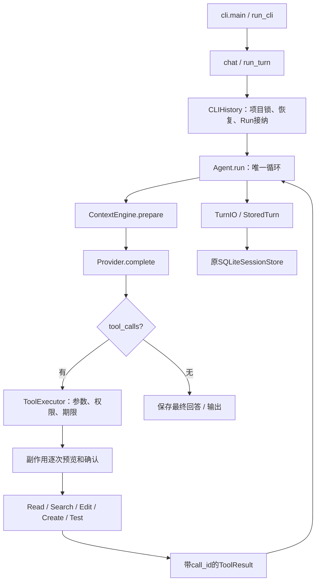

# Herta CLI v1：从一句任务到真实结果

## 整体结构

Herta独立实现Harness，模型通过兼容OpenAI的HTTP接口接入。Harness不是模型本身：它组织输入、向模型提供工具说明、校验并执行工具、记录事实，再把结果交回模型。只保留一套Loop、工具执行器、审批与SQLite存储。

`--no-save`或未指定数据目录的demo走MemoryTurn；真实模式默认走StoredTurn。两者都传入同一个`Agent.run`，并非两套Agent。

## 真实文件与入口

| 路径/关键函数 | 职责及设计取舍 |
|---|---|
| `backend/herta_agent/__main__.py`、`cli.py:main/run_cli/create_agent/chat/run_turn` | 参数、Provider和工具组装、终端输入输出；不把业务策略写进Loop。CLI本次采用非流式接口，步骤元数据由cli_events显示 |
| `runtime/agent.py:Agent.run` | 一步对应一次模型请求；有工具则校验并执行、回填、继续；无工具则提交回答。默认最多8步，每个响应最多4个工具，顺序执行，保留调用ID配对 |
| `llm/base.py`、`llm/openai_compatible.py:OpenAICompatibleProvider.complete` | Loop依赖Provider协议；适配器把内部Message转换为HTTP格式，严格解析正常结束标志；网络失败不自动重试。真实模式不会切换成固定脚本 |
| `tools/registry.py:ToolSpec/ToolRegistry` | Pydantic定义参数，生成供模型选择的JSON Schema，保存对应handler。工具名称本身不赋予权限 |
| `tools/executor.py:ToolExecutor.execute` | 查找工具、JSON解析和类型验证、side_effect审批、期限与结果大小限制，产出结构化错误；取消继续向上抛出 |
| `tools/permissions.py:TerminalApproval/confirm_once` | 展示实际diff或测试范围；正常终端默认取消，明确选择确认或输入完整yes批准本次调用；普通文本仍输入yes。不保存永久批准，不依赖模型自觉遵守提示 |
| `terminal_ui.py:TerminalUI` | Rich负责排版和差异，prompt_toolkit负责可编辑输入与确认菜单；读取原事件显示进度，不决定调用工具，不保存另一份对话 |
| `tools/coding/` | Read、字面Search、唯一替换Edit、不覆盖Create、Windows unittest。指纹校验避免旧内容覆盖新修改。沿用已有进程助手，没有新文件服务 |
| `runtime/context_engine.py:ContextEngine.prepare/_turn_groups/_summary` | 系统提示、当前轮次和工具Schema计入预算；旧历史按完整轮次选择，可做程序摘录，不能打断工具配对。完整当前轮次仍超限则结束，Session原文不删除 |
| `project_context.py:ProjectContextBuilder.snapshot` | 显式加载一份项目约定，每轮读取一次，形成不可变快照；约定不能授予工具权限；普通Read文件只是数据 |
| `runtime/session.py:Session.restore` | 校验并恢复消息顺序；Session是内存状态，不直接做I/O |
| `cli_history.py:CLIHistory.open/session/run` | 每项目独立CLI数据库和进程锁；启动恢复中断轮次；每次从已提交历史恢复后接纳Run。取消在接纳提交边界发生也会收尾，下一轮可继续 |
| `storage/turn.py:StoredTurn`、`storage/sqlite.py:SQLiteSessionStore` | 原持久化适配器共用逻辑：先落库、再更改内存；消息、工具结果与最终状态按事务保存。service/turn.py保留HTTP服务原有RunManager取消和终态策略 |

## 一次实际输入如何经过代码

2026-10-24增加了更完整的[真实案例](../verification/coding-cases-20261024/verification.md)：结算任务仍走下述同一调用链，先run_tests得到3项失败，再读取并编辑cart.py/checkout.py，回读并复测7项通过。JSON任务则新建模块和测试，收到新增断言失败后修正并复测8项通过。终端丢失后通过CLIHistory恢复，旧Run标interrupted，模型先读取真实文件再继续。这里只扩展示例、外部核查与证据；没有给案例新建另一套Agent Loop。

真实输入：“修复average空列表异常，保留非空行为，运行测试”。独立安装版实际记录见[验收](../verification/cli-v1-20261022/verification.md)。以下是实际发生的流程，模型每次运行可能选择不同工具顺序。

1. `main → run_cli`组装真实Provider与5个工具，`start_chat`打开专用SQLite；`chat → run_turn → CLIHistory.run`创建Run，使用StoredTurn调用`Agent.run`。
2. `Agent.run`拿到项目约定快照，`ContextEngine.prepare`生成本次模型输入。真实模型第1步返回`grep_code`、`read_file`调用；第2步继续Read代码与测试。调用名称与参数来自HTTP响应，没有固定脚本提前指定。
3. 第3步模型返回`edit_file`，参数包含Read返回的sha256、唯一old_text及new_text。`ToolExecutor.execute`验证参数，`TerminalApproval`显示添加空列表判断的实际差异；人工核对后输入yes。
4. handler重新核对文件与指纹，写入后返回前后SHA256收据。StoredTurn保存调用及结果。第4步模型Read回读，确认实际内容。
5. 第5步模型选择`run_tests`。再次确认后，Python测试工作进程执行本项目3个unittest并生成结构化报告；`status=passed`与退出码0进入工具结果。
6. 第6步模型不再调用工具，解释除零原因、修复与实际测试；StoredTurn事务提交最终回答及completed状态。独立checker另做4组行为断言，核对测试文件未变。
7. 新进程用同一repo和session ID恢复14条历史，再提问“上轮改了什么”，真实模型用1步回答；该恢复过程未重放编辑或测试。

## 为什么这样收敛

- 工具选择交给模型，执行决定留给Harness：拒绝、冲突和超时是实际分支，不是系统提示里的口号。
- 保留明确输入输出，不开放通用Shell：v1把Python小修复闭环做好，减少命令解析与进程控制范围。测试进程仍有当前账号权限，不能叫沙箱。
- Edit使用小范围唯一替换，多个文件没有统一事务；发生部分成功必须如实报告，不能承诺整任务回滚。
- CLI直接依赖httpx/pydantic/Rich/prompt_toolkit；后两者只负责终端交互。旧文档、桌面和本地模型依赖移到desktop/local/voice可选组。旧源码保留，CLI不装、不启动这些业务。
- 不引入多Agent、MCP、复杂Hooks、模型摘要、自动装依赖。这些不是理解基础Harness的必要条件；没有真实需要时不增加维护成本。

## 如何验证与继续学习

本次终端改动的调用链是`chat → TerminalUI.read → run_turn → 原Agent.run`。模型请求和工具执行仍走原循环；`TerminalUI.emit`仅接收原RuntimeEvent显示“正在等待模型”“已读取”等状态。副作用仍由`ToolExecutor.execute → TerminalApproval → prepare_edit → TerminalUI.preview_change/confirm → 原handler`把关。拒绝返回False，原Executor形成permission_denied结果并交回模型；没有新增审批服务。

比如本地键盘测试实际读取`note.py`的`value = 1`：默认回车得到拒绝，文件保持原样；右方向键再回车则写入`value = 2`。该测试用固定Provider，证明接线和文件结果，不能证明模型理解能力。长会话仍由原SQLite保存，输入框的上下键历史只留在当前进程。详细边界和来源见[终端验证](../verification/terminal-ui-20261022/verification.md)。

真实任务证明小闭环可用；本地测试验证拒绝、冲突、失败分类、取消和持久化边界。一次小任务不能证明任意代码库都能修好，也不提供通过率指标。来源对照在[固定版本审计](claude-code-2.1.88-audit.md)。

可选练习：打开`tools/executor.py:execute`，找到“审批返回False”与“工具超时”的返回分支，说明二者为什么都应成为带call_id的工具结果。答案：模型需要知道尝试没有完成；若只丢弃调用，下一次请求就缺少对应结果，也无法可靠决定是否继续。这个练习无需改代码。
