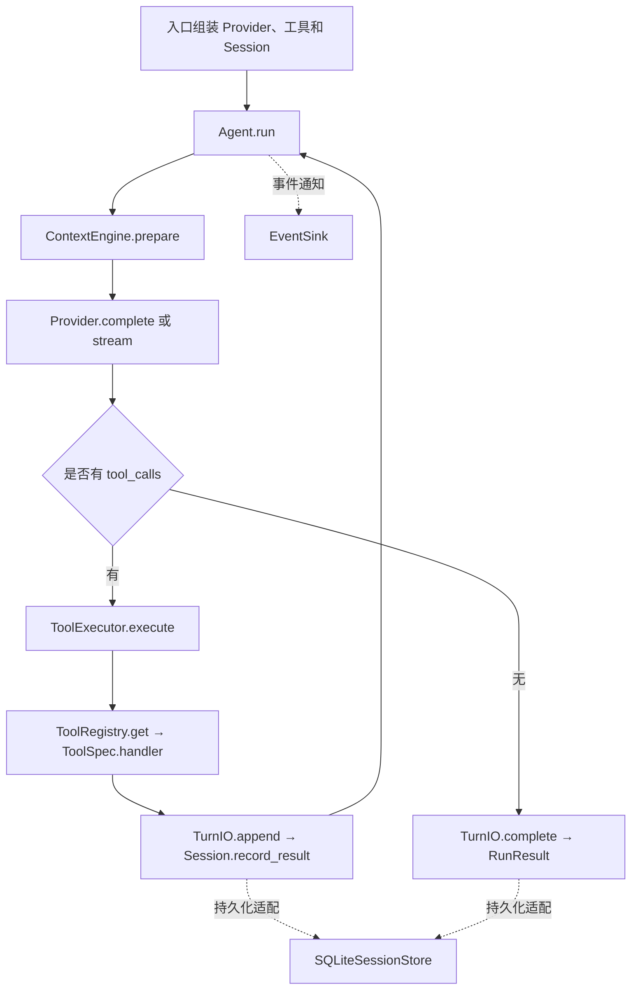

# Herta 项目地图

2026-10-24面试收敛更新：只补真实任务证据和展示，不新增教学单元。先看[面试演示](../DEMO.md)，再看[本轮实际结果](../verification/coding-cases-20261024/verification.md)；包含跨模块修复、新功能新增、真实测试失败反馈、拒绝、冲突和原会话恢复。项目Python/pytest与上下文扩展本轮暂缓。

2026-10-22交付更新：当前已收敛为可单独安装的CLI v1，默认真实模式保存会话、可恢复。最新入口是`cli.main → run_cli → start_chat → chat/run_turn → CLIHistory.run → Agent.run`；StoredTurn与原SQLite复用。整体图与真实演示见[CLI架构](../architecture/cli-v1.md)，操作见[CLI指南](../CLI_GUIDE.md)。下列编号单元保留当时学习进度，不再作为后续开发目标。

地图建立日期：2026-10-19，单元08更新于2026-10-21。当前已完成单元01～08，沿用`learning/unit-01-cli-read`，未合并主线。首个备份`e765b48`包含01～03；私密GitHub已核对检查点`683b38a`，包含01～07；08仍在本地。历史执行记录中的“未提交/未推送”保留其生成时状态，后续备份以Git实际记录为准。原始审计见单元00；[读取](unit-01-cli-read.md)、[搜索](unit-02-search-read.md)、[确认编辑](unit-03-confirmed-edit.md)、[测试验证](unit-04-test-and-verify.md)、[项目约定](unit-05-project-instructions.md)、[执行进度](unit-06-execution-trace.md)、[确认新建](unit-07-confirmed-create.md)、[窗口预算](unit-08-context-budget.md)分别对应单元01～08。

## 先建立直觉

把 Agent 看成工作室：入口接待任务，Loop 安排“问模型还是执行工具”，Registry 保存工具说明书，Executor 执行并返回结果，Context Engine 整理工作台，Session 记住当前对话，SQLite 保存档案。

对应的正式术语是：程序入口、Agent Loop、工具注册、工具执行、上下文预算、会话状态、持久化。模型决定调用什么工具；Harness 检查、执行和记录这些调用。

## 现在实际有哪些入口

| 入口 | 真实位置 | 当前行为 |
|---|---|---|
| Python CLI | [backend/herta_agent/__main__.py](../../backend/herta_agent/__main__.py) 转发到 [cli.py](../../backend/herta_agent/cli.py)，`main → run_cli → start_chat → chat → run_turn`；沿用 `herta-agent` 脚本 | 默认离线回显；真实模式自主选Read/Search/Edit/Create/Test，逐次确认副作用；真实模式默认SQLite保存，可恢复。examples中的历史学习演示仍是固定Provider；coding-task模板用于真实模型任务 |
| 桌面启动 | `启动Herta.cmd → scripts/Start-Herta.ps1 → Electron`；Python 服务入口 [service/__main__.py](../../backend/herta_agent/service/__main__.py) | 启动本机 HTTP 服务及桌面生命周期 |
| 服务组装 | [service/app.py](../../backend/herta_agent/service/app.py) 的 `create_app`/`lifespan` | 创建人格、RAG、陪伴、语音、工作台和工具；这里是主要业务耦合点 |

目标版本只有CLI产品入口。旧桌面入口与数据保留，共享持久化适配已小范围抽取并做后端回归；依赖拆分为CLI基础与桌面可选组。不能把旧桌面启动脚本当成当前CLI入口。

## 核心模块与调用关系

SQLite虚线是适配器行为，`Agent.run`不直接写数据库。内存入口用MemoryTurn；CLI用StoredTurn，服务用继承同一StoredTurn的PersistentTurn保留原RunManager终态策略。

| 模块 | 真实文件/关键符号 | 要理解的核心 |
|---|---|---|
| CLI组装 | [cli.py](../../backend/herta_agent/cli.py)，`main/run_cli/create_agent/chat/run_turn` | 入口负责组装；循环、上下文和执行仍使用已有核心 |
| 终端显示与输入 | [terminal_ui.py](../../backend/herta_agent/terminal_ui.py)，`TerminalUI.read/answer/emit/confirm` | Rich排版、prompt_toolkit输入；默认取消确认。只接入原事件和审批，不增加第二套Loop或存储；`--plain`可退回原显示 |
| 执行进度 | [cli_events.py](../../backend/herta_agent/cli_events.py)，`TerminalEventSink.emit`；原`runtime/events.py` | 可选--trace将现有事件的有限元数据写stderr；不增加对话历史或权限，默认无轨迹 |
| 只读文本 | [tools/coding/read_file.py](../../backend/herta_agent/tools/coding/read_file.py)，`ReadParameters/read_file/_read_file`；[paths.py](../../backend/herta_agent/tools/coding/paths.py)，`Repository.path` | Executor校验参数后，handler在线程中进行路径检查和有界读取；超过1MiB拒绝，结果分页保持完整行；目录限制不是操作系统沙箱 |
| 字面搜索 | [grep_code.py](../../backend/herta_agent/tools/coding/grep_code.py)，`GrepParameters/grep_code/_search`；`Repository.files` | 搜索普通UTF-8文件，返回路径与行号供后续Read；不跟随链接/特殊文件，明确预算和跳过。与Read共用`read_bounded_bytes/decode_utf8`，没有第二套文件服务 |
| 确认编辑 | [edit_file.py](../../backend/herta_agent/tools/coding/edit_file.py)，`EditParameters/prepare_edit/commit_edit`；[permissions.py](../../backend/herta_agent/tools/permissions.py)，`TerminalApproval` | Read新增全文件字节指纹；仅唯一文本替换。Executor先校验再请求一次确认；内容变化则拒绝，临时文件替换单个目标，再沿原Loop回读 |
| 确认新建 | [create_file.py](../../backend/herta_agent/tools/coding/create_file.py)，`CreateParameters/prepare_create/commit_create` | 同一审批与Loop；已有父目录里的单文件新建，暂存后os.link拒绝覆盖式发布；收据指纹供Read核对，不自动建目录或执行代码 |
| 确认测试 | [run_tests.py](../../backend/herta_agent/tools/coding/run_tests.py)，`run_tests/run_owned`；[test_worker.py](../../backend/herta_agent/tools/coding/test_worker.py)，`main` | Windows当前Python执行unittest，复用原确认器、进程Job与恢复助手；结构报告区分工具完成与测试结果，取消/超时收尾自己启动的进程树，不提供通用Shell |
| Loop | [runtime/agent.py](../../backend/herta_agent/runtime/agent.py)，`Agent.run:104`、`_request:70` | 每步问一次模型；有工具调用就执行并回填，无调用则返回；限制步数，取消时收尾；单元03只调整构造参数转发 |
| 工具说明与查找 | [tools/registry.py](../../backend/herta_agent/tools/registry.py)，`ToolSpec:17`、`ToolRegistry:44` | 名称、参数模型、handler、权限元数据放在一起；`definitions` 生成模型看到的 JSON Schema |
| 工具执行 | [tools/executor.py](../../backend/herta_agent/tools/executor.py)，`ToolExecutor.execute:67` | 查找、权限判断、参数校验、当前调用确认、期限、执行和结构化结果；工具错误可回到模型继续处理 |
| 上下文 | [runtime/context_engine.py](../../backend/herta_agent/runtime/context_engine.py)，`prepare:206`、`_turn_groups:117`；原`ContextSettings` | 保留完整用户轮次和工具配对；估算输入预算，必要时节录旧历史。CLI以--context-window传入总窗口；Session保留原文，当前轮次超限则报错。算法未重写 |
| 系统文本 | [runtime/context.py](../../backend/herta_agent/runtime/context.py)，`ContextSnapshot`、`StaticContextBuilder` | Loop 可以使用普通系统文本，不强制加载大黑塔人格 |
| 项目约定 | [project_context.py](../../backend/herta_agent/project_context.py)，`ProjectContextBuilder.snapshot`；`cli.create_agent` | 显式`--instructions`选入一份项目内UTF-8文件，每Run取一次快照；不自动扫描或导入，不增加权限，未传参数沿用StaticContextBuilder |
| 会话 | [runtime/session.py](../../backend/herta_agent/runtime/session.py)，`Session.restore/begin_turn/record_calls/record_result` | 维护历史、忙碌状态和未完成工具 ID；阻止错配的结果进入历史 |
| 每轮写入边界 | [runtime/turn.py](../../backend/herta_agent/runtime/turn.py)，`TurnIO`、`MemoryTurn` | 同一 Loop 能换内存或持久化适配器，不再造一套循环 |
| 持久化 | [storage/sqlite.py](../../backend/herta_agent/storage/sqlite.py)，`SQLiteSessionStore:149`、`admit_run:412`、`finish_run:498`、`recover_interrupted:586` | 事务保存消息与运行状态，恢复中断状态；数据库线程归单独 worker 所有 |
| CLI与服务适配 | [cli_history.py](../../backend/herta_agent/cli_history.py)，`CLIHistory.run`；[storage/turn.py](../../backend/herta_agent/storage/turn.py)，`StoredTurn`；[service/turn.py](../../backend/herta_agent/service/turn.py)，`PersistentTurn` | 共用store-first写入；CLI顺序接纳，服务保留RunManager并发/取消策略；没有复制存储或第二套Loop |
| 模型适配 | [llm/base.py](../../backend/herta_agent/llm/base.py)、[llm/openai_compatible.py](../../backend/herta_agent/llm/openai_compatible.py)、[llm/streaming.py](../../backend/herta_agent/llm/streaming.py) | Provider 协议可替换；HTTP 与流式协议解析不进入 Loop；本轮未调用远程模型 |

服务中持久化顺序为`RunManager.submit → _admit_and_launch → store.admit_run → _execute → store.start_run → Session.restore → PersistentTurn → Agent.run`，最终通过原manager._finish提交。CLI则`CLIHistory.run → store.admit_run/start_run → StoredTurn → Agent.run`，复用同一SQLite事务与恢复校验。适配代码见最新CLI架构文档。

## 跟踪一个真实输入

以下使用仓库已有 [test_tool_loop.py](../../backend/tests/test_tool_loop.py) 中 `test_multiple_steps_and_tool_errors_are_fed_back_in_order` 的输入 `go`。**这是静态读源追踪，本轮没有执行该测试。** `ScriptedProvider` 是测试夹具，不是会理解 `go` 的真实模型。

1. 测试构造 `Session()`、`echo_registry()` 和 `ScriptedProvider`，调用 `Agent.run(session, "go")`。
2. `MemoryTurn.begin → Session.begin_turn` 添加用户消息；`ContextEngine.prepare` 拼入系统文本、完整历史和工具 Schema。
3. 第一次 `Provider.complete` 按测试脚本声明两个调用：`echo({"text":"你好"})` 和不存在的 `unknown`。
4. `ToolExecutor.execute → registry.get → EchoParameters.model_validate_json → echo` 得到 `{"text":"你好"}`；另一个调用得到 `unknown_tool`。`MemoryTurn.append → Session.record_result` 按各自 ID 回填。
5. 第二次 Provider 声明参数为不完整 JSON `{` 的 echo，Executor 返回 `invalid_arguments`，Loop 继续回填，不伪造成功。
6. 第三次 Provider 返回文本 `done`；`MemoryTurn.complete` 添加最终回答，Loop 构造 `RunResult(reply="done", steps=3, ...)`。

测试源码断言的角色序列为 `user → assistant → tool → tool → assistant → tool → assistant`，工具结果 ID 为 `a、b、c`。这是可核对的预期，不是本轮新获得的运行结果。

几个容易混淆的名称：`Session` 是持续对话；一次用户消息触发一个 `Run`；`Step` 是一次模型请求，同一步可以有多个 `ToolCall`。`spec` 指工具说明，`parameters` 指校验后的参数，`turn` 指本轮提交边界。`ToolResult.ok` 只表示工具是否完成其调用，不能自动等同于业务测试通过。

## 当前能力边界

- Context Engine 是可替换的词面 Token 估算与历史节录；不等于供应商精确计费，也不等于 Claude Code 的完整自动压缩。当前单轮必需内容过大时会拒绝，不能保证长 Coding 任务连续完成。
- Executor保留旧`tool_policy(spec)`兼容原服务，CLI改选`authorize(spec, parameters)`，二者互斥，不叠加两套审批。编辑与Windows unittest分别逐次确认；不支持通用Shell、pytest或自动安装依赖。执行的测试拥有当前用户权限，起始目录检查不限制Python代码后续访问，不是操作系统沙箱。
- 旧陪伴 Skills 在 `companion/personalization.py:208` 的 `context_skills` 中作为已审核文字进入 `CompanionContext.snapshot`；不是 CLI 的目录发现与按需加载。
- `RuntimeEvent/EventSink` 已通过CLI的--trace呈现执行进度，不是完整Hooks系统；多个Session也不等于已实现子Agent。
- 用户级 `$guided-development` Skill 管理 **Codex 和用户的教学协作**，适用于不同项目；Herta 的专属约定保留在根目录 `AGENTS.md`。这不表示 Herta 产品已经具备同名 Skill 运行能力。

## 阅读顺序

先沿上面的 `go` 输入阅读 Loop、Registry、Executor、Session，再看 Context Engine；理解内存提交边界后再看 SQLite 和服务适配。旧 coding 工具的价值与后续目录方案见 [单元00审计](unit-00-architecture-audit.md)。
