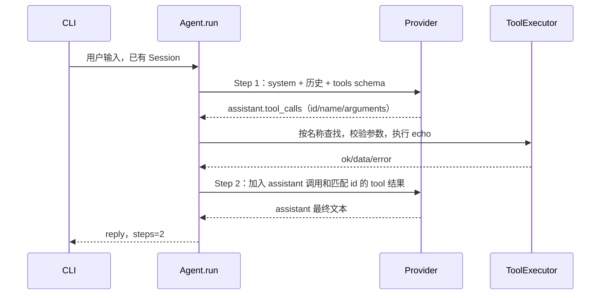

# Phase 2：亲手复现工具调用闭环

当前目标已经从“模型回答一句话”推进到“模型要求调用工具 → Python 执行 → 把结果交还模型 → 模型回答”。本阶段仍是 Windows 命令行，只有无副作用的 echo 工具。原始语料没有改动，Persona 与 RAG 留到后续阶段。

## 1. 先运行，再读代码

在 PowerShell 中执行：

```powershell
Set-Location -LiteralPath 'D:\Desktop\herta-agent'
.\.venv\Scripts\python.exe -m herta_agent --demo-tools --message '你好，黑塔'
```

预期输出包含：

```text
模式：离线演示（固定逻辑，不调用 LLM，不读取 API Key）
Assistant: [离线工具演示] 工具结果：{"ok": true, "data": {"text": "你好，黑塔"}, "error": null}
[steps=2]
```

这里的工具确实经过 Registry、参数校验和 Executor。演示 Provider 按固定规则产生工具请求，再把回填结果展示出来；它不模拟真正的语言理解。默认不加 --demo-tools 的普通回显模式仍然只用 1 个 Step。

## 2. 为什么一次输入用了两个 Step



模型只能提出调用请求。执行权仍在 Python：只允许注册过的工具，并按参数模型验证；不会把模型文本当成 Python 或 PowerShell 执行。

成功后的 Session 历史有四条：user、assistant（含 tool_calls）、tool（含 tool_call_id）、assistant（最终文本）。system 每次构建请求时添加，不反复存入历史。

工具失败也可以继续闭环。例如工具参数错误，Executor 返回结构化失败结果，由模型决定如何回答或在剩余 Step 内修正。用户取消则直接停止 Run，不再请求模型。

## 3. 当前文件如何分工

```text
backend/herta_agent/
  __main__.py                 同步输入循环、Runner、工具装配
  config.py                   max_steps / request_timeout / tool_timeout
  runtime/
    messages.py               不可变消息、ToolCall、按角色生成网络字段
    session.py                会话执行权、历史、待回填的工具 id
    agent.py                  请求模型、执行工具、继续循环、预算/取消
    errors.py                 可向用户显示的运行错误
  llm/
    base.py                   complete(messages, tools=...) 协议
    demo.py                   普通演示和两步工具演示
    openai_compatible.py      HTTP tools schema 与 tool_calls 适配
  tools/
    registry.py               ToolParameters、ToolSpec、显式注册表
    executor.py               严格验证、异步执行、期限、JSON 结果
    echo.py                   EchoParameters、echo、默认注册表
backend/tests/
  test_tools.py               工具单独验证
  test_tool_loop.py           历史配对、多步骤、预算、超时、取消
  test_tool_provider.py       模拟 HTTP 服务验证实际适配器闭环
  test_cli.py                 CLI 子进程回归与演示验证
  cli_interrupt_probe.py     隔离进程中的 Windows SIGINT 验证辅助程序
```

之前的 test_provider.py、test_runtime.py 继续覆盖 Phase 1 行为。新工具模块没有新增第三方依赖。

## 4. 建议精读这 5 个函数

1. [ToolRegistry.definitions](D:/Desktop/herta-agent/backend/herta_agent/tools/registry.py)：从同一个 Pydantic 参数模型生成模型可见 schema。沿着 register/get 看名称如何对应 handler。
2. [ToolExecutor.execute](D:/Desktop/herta-agent/backend/herta_agent/tools/executor.py)：依次查名称、解析并验证 JSON、等待异步 handler、返回统一结果。为什么捕获 Exception 却不捕获 CancelledError？
3. [Agent.run](D:/Desktop/herta-agent/backend/herta_agent/runtime/agent.py)：工具分支用 continue 进入下一次模型请求，文本分支 return。重点看最后一个 Step 为什么不再执行工具。
4. [Session.close_pending](D:/Desktop/herta-agent/backend/herta_agent/runtime/session.py)：为尚无结果的 id 补齐记录。已完成工具不被取消结果覆盖，每个调用只回填一次。
5. [chat](D:/Desktop/herta-agent/backend/herta_agent/__main__.py)：Session 和 Runner 在多轮输入间保留，每个 runner.run 只执行当前一轮；结合 run_turn 的 Windows 唤醒定时器阅读。

用户原有的 agent.py、session.py 中文学习注释已保留。

## 5. 复现失败、期限与取消

工具超时（仍然是正常的两步模型闭环，最终结果包含 timeout）：

```powershell
.\.venv\Scripts\python.exe -m herta_agent --demo-tools --demo-delay 1 --tool-timeout 0.02 --message '演示超时'
```

预算耗尽（只允许一次模型请求，echo 不执行，CLI 退出码为 1）：

```powershell
.\.venv\Scripts\python.exe -m herta_agent --demo-tools --max-steps 1 --message '演示预算'
$LASTEXITCODE
```

手动取消后继续聊天：

```powershell
.\.venv\Scripts\python.exe -m herta_agent --demo-tools --demo-delay 5 --tool-timeout 10
```

输入第一句后，在 5 秒等待中按一次 Ctrl+C。预期出现“已取消当前轮，会话已保留”，然后重新显示 You:。输入第二句并等待完成；输入 /exit 退出。输入阶段按 Ctrl+C 只取消输入。单条 --message 模式没有后续输入循环，因此取消后退出 130。

在 Windows 上不使用 loop.add_signal_handler、SIGALRM、fork 或 POSIX 进程组。Runner 的标准 SIGINT 行为先取消顶层任务；工具的 finally、Runtime 的未完成结果闭合和 Session 释放依次发生；最后 CLI 捕获 KeyboardInterrupt。run_turn 用每 0.1 秒的短定时器让等待中的事件循环有机会处理 Python 信号，结束后移除定时器，不使用 stdin 工作线程。

依据：[Python 3.12 Runner 的 Ctrl+C 行为](https://docs.python.org/3.12/library/asyncio-runner.html#handling-keyboard-interruption)、[asyncio 的 Windows 限制](https://docs.python.org/3.12/library/asyncio-platforms.html#windows)。快速重复 Ctrl+C 属于 Python 的强制中断路径，不承诺第二次强制中断时仍能完成协作清理。

## 6. 真实模型配置

```powershell
$env:HERTA_BASE_URL = 'https://你的服务地址/v1'
$env:HERTA_MODEL = '你的模型名'
.\.venv\Scripts\python.exe -m herta_agent --provider openai
```

API Key 仍通过不回显输入或当前进程环境变量提供，不写入项目。可以输入“请调用 echo 工具回显：你好”。CLI 默认注册 echo 并向服务商发送 tools；模型是否调用由它决定，服务商需支持现代 Chat Completions function tool_calls。本阶段不支持旧 function_call 协议。

取消会关闭当前客户端的等待并停止本地后续执行；远端服务是否继续计算或收费取决于供应商，不能由本地 Task.cancel 保证。

## 7. 验证与实现顺序

本次按以下次序编写：工具行为测试（观察缺失接口失败）→ Registry/Executor → 循环测试 → 消息/Session/Agent → HTTP 合约测试 → Provider → CLI/SIGINT 测试 → Runner 交互。你可以按相同顺序重新实现，每次只补齐对应层。

```powershell
.\.venv\Scripts\python.exe -m unittest discover -s backend/tests -v
.\.venv\Scripts\ruff.exe check backend
.\.venv\Scripts\ruff.exe format --check backend
```

最终验证：42 项测试通过，Ruff 检查与格式检查通过。自动测试包含真实 Agent/Session/Executor 组合和 MockTransport 网络边界；SIGINT 测试在单独的 Windows Python 进程中，后台定时器触发信号，依次取消等待中的模型和工具，然后验证同一会话第三轮成功；另一子进程验证单条消息取消退出 130 且无 traceback。它验证信号处理路径，不代表所有终端宿主的物理键盘事件都已人工测试。

目前工具是原生 async 协作式实现，超时不能强行杀死任意阻塞线程或不让出控制权的同步函数。未来有进程/文件工具时再设计相应 Windows 边界。本阶段未验证真实供应商 API，未加入持久化、Persona、RAG、SSE 或桌面 UI。

自测问题：max_steps=2 时为什么 echo 可以成功？同一回复有三个工具，第二个被取消后应有几条 tool 结果？参数错误为什么可以回传给模型，而用户取消不继续请求模型？
