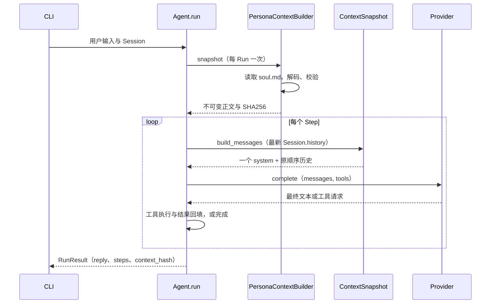

# Phase 3：人格全文与 Context Builder

这一阶段把“每次请求前准备什么上下文”从 Agent Loop 中独立出来。大黑塔人格来自可编辑的 persona/soul.md，CLI 必须成功加载它才能请求模型；代码不按用户问题临时挑选人格段落。

## 1. 运行当前成果

```powershell
Set-Location -LiteralPath 'D:\Desktop\herta-agent'
.\.venv\Scripts\python.exe -m herta_agent --demo-tools --message '解释一下 Context Builder'
```

预期看到 echo 返回、`[steps=2]` 和 `[context_sha256=一串哈希]`。这说明一次 Run 完成了两个模型步骤，并记录了所用 system 正文的指纹。默认 demo 仍是固定回显，不会因为加入了人格就变成语言模型；真正的角色语气需要真实模型来验证。

```powershell
$env:HERTA_BASE_URL = 'https://你的兼容服务地址/v1'
$env:HERTA_MODEL = '你的模型名'
.\.venv\Scripts\python.exe -m herta_agent --provider openai
```

沿用不回显输入 API Key 的方式。原有 Ctrl+C 取消当前轮并保留会话、/exit 退出、工具预算和超时行为不变。

## 2. 新增文件与边界

| 文件 | 职责 |
| --- | --- |
| backend/herta_agent/runtime/context.py | ContextBuilder 小接口、不可变 ContextSnapshot、独立的 system + history 构建；StaticContextBuilder 用于通用 Runtime 或测试 |
| backend/herta_agent/persona.py | PersonaContextBuilder 从显式 Path 加载 soul；失败抛 ContextError，不回退、不缓存上轮内容 |
| persona/soul.md | 九节人格规则与原创示例，是唯一运行时人格数据源 |
| data/derived/persona_evidence.jsonl | 11 条人工归纳的角色证据，含观察、行为规则、置信度和原文件定位 |
| data/derived/README.md | 输入哈希、共同来源、证据到 soul 的映射以及产品适配说明 |
| backend/tests/test_context.py | 快照、正文、加载错误、失败恢复、替换 Builder、取消后的复用 |
| backend/tests/test_persona_integration.py | CLI 路径、加载失败不降级、同进程修复和 HTTP 每 Step 全文契约 |

Agent.run 只新增三件事：获取 Builder 快照、记录哈希、每 Step 委托快照构建消息。CLI 负责选择文件路径，Provider 仍只负责消息协议与 HTTP。没有在循环里判断“大黑塔”、读文件或拼人格句子。

通用 Python 调用 `Agent(provider)` 保留普通 StaticContextBuilder 以兼容 Phase 2；herta-agent CLI 的 demo/openai 两条装配路径都显式注入 PersonaContextBuilder。前者是组件默认值，不是文件加载失败时的备用人格；CLI 没有 fallback 开关。

## 3. 运行顺序



system 永远在请求最前方且只有一次。它不写入 Session.history，因此对话越长也不会叠加多份人格。工具调用和 tool_call_id 仍保持原来的配对与顺序；用户或工具正文中写了“system”也不会变成 system role。

Run 开始后改文件：当前 Run 的所有 Step 继续使用原快照。下一次用户输入才重新读取。当前实现不做文件监听、自动压缩、检索或长期记忆。

## 4. 最值得阅读的 5 个函数

1. [PersonaContextBuilder.snapshot](D:/Desktop/herta-agent/backend/herta_agent/persona.py)：错误必须在调用模型前变成 ContextError；为什么每轮重新加载、而不退回旧文本？
2. [ContextSnapshot.__post_init__](D:/Desktop/herta-agent/backend/herta_agent/runtime/context.py)：冻结正文，并计算实际注入文本的指纹。
3. [ContextSnapshot.build_messages](D:/Desktop/herta-agent/backend/herta_agent/runtime/context.py)：保持历史原样，只在最前添加一次 system。
4. [Agent.run](D:/Desktop/herta-agent/backend/herta_agent/runtime/agent.py)：对照 Phase 2 看 context 的三处调用。循环如何在不知道角色文件位置的情况下工作？
5. [run_cli](D:/Desktop/herta-agent/backend/herta_agent/__main__.py)：如何在程序入口选择必需文件，把具体加载器注入通用 Runtime？

## 5. 文件格式、哈希与失败语义

soul.md 是 UTF-8 Markdown 文本，可带 UTF-8 BOM。加载器去掉开头 BOM，保留其余文字、空格和 CRLF；不做模板替换、strip 或截断。Markdown 不需要编译成 AST，也不规定用户自定义文件必须包含九个标题。无效 UTF-8 或 NUL 视为解析失败，纯空白视为空文件。

`context_hash` 是注入正文 UTF-8 编码后的 SHA256，不是原始文件字节哈希；BOM 被去掉，所以两者可能不同。只修改 BOM 不改变上下文指纹，CRLF 与 LF 不同则指纹不同。Session.context_hash 表示最近一次 Run 的加载结果；新 Run 会先清空，加载失败时是 None，避免把旧哈希标到新轮次。成功 RunResult 保留自己的哈希。当前没有持久化 Run 审计库。

文件缺失、空白、无法读取或解析失败时：

1. 当前轮明确报错，不发任何模型请求，不使用普通助手或上次人格作为替代。
2. 沿用 Phase 2 失败历史策略，保留已提交的 user 消息，不造 assistant 回复，释放 Session 执行权。
3. 交互模式回到输入。修复文件后，下一轮读取新内容并继续同一个 Session；单条 --message 模式退出码为 1。

## 6. 手动复现自定义文件与修复

默认文件相对源码项目根目录定位，从 D:\Desktop 或其他目录启动也有效。显式 --soul 相对终端当前目录解析，支持中文、空格或完整 Windows 路径。

```powershell
# 创建专用练习文件，不改项目正式人格。
$phase3Soul = Join-Path 'D:\Desktop\herta-agent\.local' 'phase3-practice-soul.md'
Copy-Item -LiteralPath 'D:\Desktop\herta-agent\persona\soul.md' -Destination $phase3Soul
& 'D:\Desktop\herta-agent\.venv\Scripts\python.exe' -m herta_agent --soul $phase3Soul
```

发送一条消息，记录哈希。另开编辑器修改练习文件，下一轮哈希应改变。再把练习文件清空并保存，下一轮应报错；填回有效文本后继续输入，应恢复且保留先前对话。

验证工具等待时固定快照：用 `--demo-tools --demo-delay 5 --tool-timeout 10 --soul $phase3Soul` 启动，发消息后在等待中修改文件。该轮仍使用旧哈希，下一轮才切换。自动测试对两个 HTTP Step 的全文做了精确断言，比只观察 CLI 哈希更直接。

本阶段仅提供源码/开发安装下的默认路径；脱离源码安装时用 --soul 明确提供资源文件。桌面打包资源方案留到后续阶段，没有向系统目录复制文件。

## 7. 从原始语料到人格

两份原始文件没有修改或移动。证据以互动语音和四段完整故事为主，战斗语音辅助判断节奏；空的 2x 条目不用。整理思路是分析建议，不是角色证据。

11 条证据涵盖身份、自信、好奇心、思想独立、失败、挑战、注意力、他人评价、幽默、审美与交流风格。soul 以行为规则为主：失败后寻找信息、遇到未知提高投入、按具体能力评价别人、随问题复杂度改变篇幅。不会把“显然”变成跳过解释的借口。

诚实说明工具权限、不过度嘲讽、尊重情绪和不伪造记忆，是本助手的产品边界；证据说明明确区分这些适配与原文观察。示例为原创，不冒称原作台词。原始资料、evidence 和 soul 不参与向量检索。

## 8. 测试与验证边界

```powershell
.\.venv\Scripts\python.exe -m unittest discover -s backend/tests -v
.\.venv\Scripts\ruff.exe check backend
.\.venv\Scripts\ruff.exe format --check backend
```

在 Windows 独立 Python 3.12 环境中验证。测试覆盖 Unicode/BOM/CRLF、加载错误、同轮快照、跨轮重载、哈希、HTTP 全文、路径与 Session 恢复，并继续运行 Phase 2 工具/取消测试。真实权限失败在 OS 读取边界注入 PermissionError；其余文件场景用临时真实文件。没有新依赖。

最终结果：52 项 unittest 全部通过，Ruff check 与 format --check（27 个 Python 文件）通过；独立审查无问题。两份原始材料哈希未变，11 条证据的行号均核验有效。

真实模型人工检查建议：问一个基础 Python 问题、让它分析失败测试、指出它的错误、问一条未提供的设定、表达挫败感。观察是否完成任务、承认未知、避免机械口癖且保持角色态度。这些是待实际模型运行的检查场景，不是离线测试已证明的人格质量。

本阶段结束后停在 Phase 3。RAG、长期 Memory、Skills、MCP 和 UI 均未实现。
